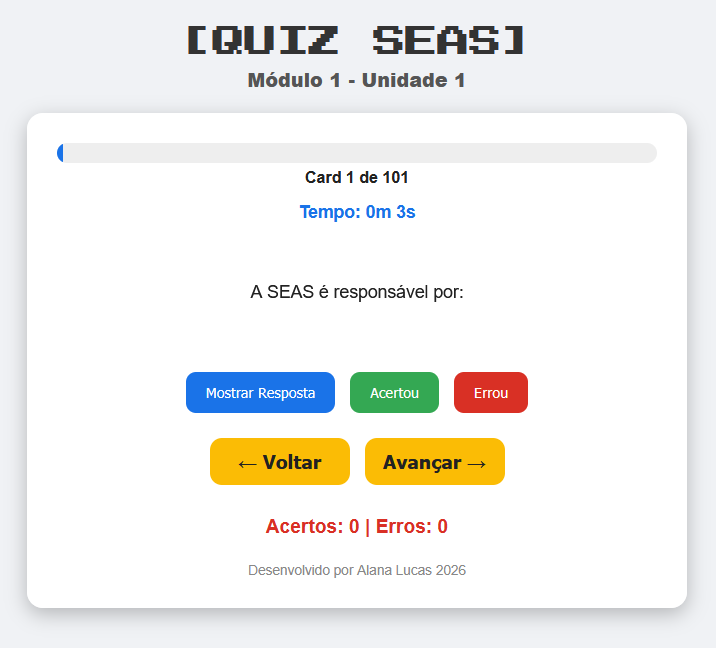

# 🎮 QUIZ SEAS

## 📚 Sobre o projeto

O **QUIZ SEAS** é um jogo educativo desenvolvido em HTML, CSS e JavaScript, com o objetivo de auxiliar nos estudos sobre o Sistema Socioeducativo do Estado do Ceará.

A ferramenta funciona por meio de flashcards de perguntas e respostas, abordando temas como SEAS, ECA, SINASE, direitos humanos, medidas socioeducativas e atuação profissional.

A ideia é tornar a revisão dos conteúdos mais dinâmica, facilitando a memorização e permitindo que o próprio usuário acompanhe seu desempenho.

## ⚙️ Funcionalidades

- Perguntas e respostas em cartões interativos.
- Opção de visualizar a resposta.
- Registro de acertos e erros.
- Navegação entre as questões.
- Barra de progresso.
- Cronômetro de estudo.
- Pontuação e percentual de aproveitamento ao final.
- Sons para indicar acertos e erros.
- Embaralhamento das questões ao reiniciar.

## 🛠️ Tecnologias utilizadas

- HTML5
- CSS3
- JavaScript

## 🚀 Como executar

1. Baixe ou clone o repositório.
2. Abra a pasta do projeto.
3. Execute o arquivo `index.html` em seu navegador.
4. Comece a jogar e testar seus conhecimentos!

## 👩‍💻 Desenvolvedora

**Alana Lucas — 2026**

Projeto desenvolvido com finalidade educacional, como ferramenta de apoio à aprendizagem e revisão dos conteúdos relacionados ao Sistema Socioeducativo.

---

**Bons estudos! A prática leva à perfeição!** 🎯